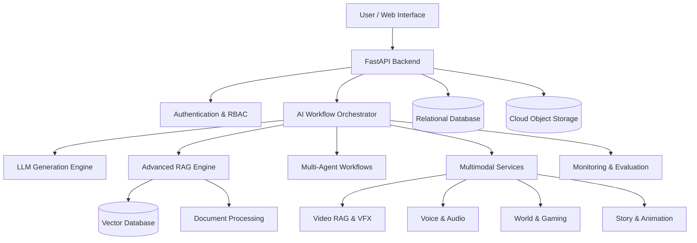

# 🧠 NeuroWorld AI
### Enterprise-Grade Generative AI, Agentic Intelligence & Multimodal Creative Platform

**An intelligent AI-powered ecosystem for generative content, multimodal understanding, autonomous workflows, immersive experiences, and secure cloud collaboration.**


**Project Status:** In Development  
**Category:** Generative AI | Agentic AI | Multimodal AI | Full-Stack AI Engineering  
**Developer:** PA Mohammed Hamil

---

## 🌍 Overview

NeuroWorld AI is an ambitious, modular artificial intelligence platform designed to unify advanced generative AI, intelligent agents, multimodal content understanding, creative production, and secure digital workspaces.

The project explores how modern AI architectures can combine large language models, retrieval-augmented generation, tool-using agents, computer vision, speech technologies, and cloud-native infrastructure into a cohesive application.

### 🎯 Vision

Build a scalable AI ecosystem where users can:

- Create and manage AI-powered projects.
- Generate stories, videos, animations, comics, and digital characters.
- Analyze documents, images, audio, and videos.
- Ask contextual questions using advanced RAG.
- Automate complex tasks through specialized AI agents.
- Develop interactive digital worlds and gaming experiences.
- Securely store, search, and manage creative assets.
- Monitor AI workflows, generation jobs, and system performance.

> NeuroWorld AI is a portfolio engineering project. Individual capabilities may be prototypes, under development, or planned. Features should not be interpreted as production-ready without corresponding implementation and testing.

---

## ✨ Core Features

### 1. 🤖 Generative AI Engine

- Multi-provider LLM integration architecture
- Context-aware AI text generation
- Structured JSON generation
- Prompt templates and reusable workflows
- Creative writing and content generation
- Model configuration and version tracking
- Generation history and job management
- Token usage and inference monitoring

### 2. 🧠 Advanced RAG Intelligence

Designed to support:

- Document ingestion and preprocessing
- Semantic chunking
- Vector embeddings and similarity search
- Hybrid keyword and vector retrieval
- Query rewriting and multi-query retrieval
- Cross-encoder reranking
- Contextual compression
- Source-grounded answer generation
- Retrieval evaluation
- Permission-aware document access

### 3. 🕸️ Agentic AI & Multi-Agent Orchestration

Modular agent architecture for:

- Planning and task decomposition
- Content generation
- Story development
- Research and retrieval
- Asset management
- Video understanding
- Quality review
- Workflow coordination

Engineering considerations include agent checkpoints, workflow state, retries, tool permissions, human approval, and execution tracing.

### 4. 🎬 AI Movie & Video Studio

Planned creative capabilities:

- Text-to-video workflows
- Image-to-video generation
- Storyboard-to-scene production
- AI-assisted movie development
- Scene sequencing
- Video summarization
- Video question answering
- Timeline-based editing
- Video asset organization
- Visual effects integration

### 5. 🎨 Animation, Comics & Character Intelligence

- AI character creation
- Character appearance consistency
- Character voice profiles
- Scene and environment design
- Comic panel generation
- Animation workflow management
- Character emotion and expression planning
- Story-to-storyboard conversion
- Reusable character and cast libraries

### 6. 🎮 Interactive Gaming & World Intelligence

Research and development areas:

- AI-powered NPC behavior
- Dynamic storytelling
- Interactive game levels
- World and environment management
- Agent-driven NPC conversations
- Contextual world knowledge
- Interactive narrative workflows

### 7. 🎙️ Voice & Audio Intelligence

- Speech-to-text integration
- Text-to-speech integration
- Voice-based interactions
- Character voice management
- Audio processing workflows
- Multilingual AI interaction architecture

### 8. 📚 Video RAG & Semantic Search

- Video upload and indexing
- Video transcript processing
- Timestamp-aware segmentation
- Semantic video search
- Natural-language video Q&A
- Source timestamp references
- Video document metadata management

### 9. ☁️ Secure Cloud Asset Workspace

- User workspaces and projects
- Asset uploads and organization
- Upload session tracking
- File metadata and versioning
- Cloud storage adapters
- Vector collection management
- Searchable project assets
- Access-controlled asset retrieval

### 10. 🔐 Enterprise Security Architecture

Security-oriented modules include:

- Authentication and authorization
- Role-based access control
- Consent management
- Session security
- Audit logging
- File upload validation
- Tenant isolation
- Sensitive data protection
- Abuse and incident reporting
- Security event tracking
- Account recovery and appeal workflows

Security is an engineering objective, not a claim of completed security certification or independent audit.

---

## 🏗️ System Architecture



---

## 🛠️ Technology Stack

| Layer | Technologies / Architecture |
|---|---|
| Programming | Python, JavaScript, SQL |
| Backend | FastAPI, Pydantic, REST APIs |
| AI / LLMs | OpenAI, Gemini, Hugging Face integrations |
| AI Frameworks | PyTorch, Transformers, LangChain, LangGraph |
| Retrieval | Embeddings, Hybrid Search, Reranking |
| Databases | PostgreSQL, Redis |
| Vector Search | FAISS, Chroma, pgvector |
| Media AI | Computer Vision, ASR, TTS, Video Processing |
| Storage | S3-compatible object storage |
| Background Jobs | Worker and queue architecture |
| Infrastructure | Docker, Cloud Deployment |
| Monitoring | Structured Logs, Metrics, Tracing |
| Security | RBAC, Consent, Audit Logs, Upload Validation |

*This table describes the intended technology ecosystem; actual dependencies and integrations should be verified against the repository.*

---

## 📂 Project Structure

The following is a conceptual module organization. It is not a verified directory listing.

```text
neuroworld-ai/
│
├── app/
│   ├── api/
│   ├── core/
│   ├── models/
│   ├── schemas/
│   ├── services/
│   │   ├── auth_service.py
│   │   ├── generation_service.py
│   │   ├── story_service.py
│   │   ├── render_service.py
│   │   ├── semantic_search_service.py
│   │   ├── vector_storage_service.py
│   │   ├── video_rag_service.py
│   │   ├── voice_service.py
│   │   ├── vfx_service.py
│   │   ├── world_service.py
│   │   ├── upload_service.py
│   │   └── notification_service.py
│   │
│   ├── agents/
│   ├── rag/
│   └── security/
│
├── tests/
├── scripts/
├── docs/
├── frontend/
├── requirements.txt
├── .env.example
├── Dockerfile
└── README.md
```

---

## 🚀 Local Development

### Prerequisites

- Python 3.11 or newer
- Git
- Configured database and external services as required
- Provider API keys for enabled integrations

### 1. Clone the Repository

```bash
git clone https://github.com/pa-mohammed-hamil/neuroworld-ai.git
cd neuroworld-ai
```

Replace the URL if the actual repository uses a different name.

### 2. Create a Virtual Environment

```bash
python -m venv .venv
```

Windows:

```bash
.venv\Scripts\activate
```

Linux / macOS:

```bash
source .venv/bin/activate
```

### 3. Install Dependencies

```bash
pip install -r requirements.txt
```

### 4. Configure Environment

```bash
cp .env.example .env
```

On Windows Command Prompt:

```cmd
copy .env.example .env
```

Configure the required environment variables according to `.env.example`. Never commit real API keys or credentials.

### 5. Start the Backend

If the FastAPI application object is located at `app/main.py`:

```bash
python -m uvicorn app.main:app --reload
```

Default local API documentation:

```text
http://127.0.0.1:8000/docs
```

**Note:** The startup command assumes a conventional FastAPI layout. Verify the actual application entry point before running.

---

## 🧪 Testing & Quality Engineering

The engineering roadmap includes:

- Unit testing
- API integration testing
- Retrieval quality evaluation
- Agent workflow testing
- Structured output validation
- Prompt injection resistance testing
- Access-control verification
- Upload security testing
- Latency and throughput benchmarking
- AI output quality assessment
- Regression testing

### Example Test Command

```bash
python -m pytest tests/ -v
```

Test coverage and benchmark results will be published when reproducible evaluations are available.

---

## 📊 AI Engineering & Evaluation

| Dimension | Evaluation Objective |
|---|---|
| Retrieval | Recall@K, MRR, relevance |
| Generated Answers | Groundedness and citation accuracy |
| Agent Workflows | Completion rate and tool reliability |
| Inference | Latency, tokens, estimated cost |
| Video RAG | Timestamp and answer relevance |
| Security | Authorization and isolation tests |
| Reliability | Error rates and recovery behavior |
| Media Generation | Human-reviewed quality and consistency |

No benchmark results are claimed until measured.

---

## 🗺️ Development Roadmap

- [ ] Complete core API and database integration
- [ ] Implement secure authentication and workspace management
- [ ] Integrate initial LLM provider
- [ ] Deliver document ingestion and semantic retrieval
- [ ] Build agent orchestration with checkpointing
- [ ] Integrate video RAG and media pipelines
- [ ] Develop story, animation, and character workflows
- [ ] Implement observability and evaluation dashboards
- [ ] Add automated integration and security tests
- [ ] Deploy a reproducible public demonstration
- [ ] Publish architecture diagrams and benchmark evidence

Update checkboxes only after implementation and verification.

---

## 🖼️ Screenshots & Demonstrations

Screenshots, architecture visuals, and demo recordings will be added as development progresses.

Recommended demonstrations:

1. AI generation workspace
2. Semantic document and video search
3. Multi-agent workflow execution
4. Creative studio interface
5. Secure asset and project management
6. AI observability dashboard

---

## 💡 Engineering Challenges

NeuroWorld AI explores several practical AI engineering challenges:

**Retrieval reliability:** Combining semantic search with grounding and evaluation to reduce unsupported answers.

**Agent reliability:** Managing workflow state, retries, checkpoints, permissions, and human oversight.

**Multimodal processing:** Coordinating text, image, audio, and video pipelines through consistent APIs.

**Scalable execution:** Separating interactive requests from computationally expensive generation jobs.

**AI security:** Protecting user assets, controlling tool access, validating uploads, and recording sensitive actions.

**Production observability:** Measuring AI quality alongside conventional software performance and reliability.

---

## 👨‍💻 About the Developer

**PA Mohammed Hamil**  
*Aspiring Generative AI Engineer | AI Engineer | Agentic AI Developer*

BCA Graduate — First Class, University of Calicut (2026).

Technical interests include:

- Generative AI and LLM Engineering
- Retrieval-Augmented Generation
- Agentic AI and Multi-Agent Systems
- Machine Learning and Deep Learning
- Python Backend Development
- Cloud, MLOps and LLMOps
- AI Security and Production Engineering

**Coding Achievements**

- 400 LeetCode problems solved
- HackerRank Gold badges in Python, SQL, and Problem Solving

### Connect

- **GitHub:** https://github.com/pa-mohammed-hamil
- **Portfolio:** https://pa-mohammed-hamilgithubio.vercel.app

---

## ⚠️ Disclaimer

NeuroWorld AI is an independently developed AI engineering portfolio project.

Some modules and integrations are experimental or planned. Generated content may require human review. Security-sensitive workflows and external actions must be validated before production deployment.

Third-party models, media assets, and external services remain subject to their respective licenses, terms, and usage policies.

---

### ⭐ NeuroWorld AI — Engineering Intelligent Digital Experiences

*Building at the intersection of Generative AI, Agentic Systems, Multimodal Intelligence, and Cloud-Native Software Engineering.*

**If you find the project interesting, consider starring the repository.**
